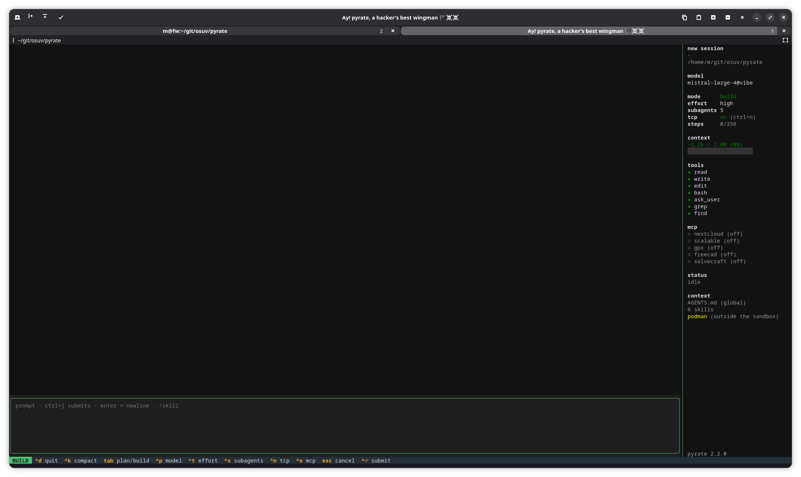

# pyrate 🏴‍☠️



**tl;dr:** minimal coding harness with tui and headless mode. one loop, a handful of tools, only the configured backends. deps: `textual`, `pyyaml`, http via stdlib.

- tools: `read`, `write`, `edit`, `bash`, `ask_user`, `grep`, `find`, plus mcp (stdio, http, oauth)
- plan mode (read-only) and build mode, toggle with tab
- sandbox: tools and bash only in the cwd and a dedicated tmp, bash via landlock
- sessions in sqlite, resumable and searchable
- compaction when the context is full, AGENTS.md and skills global and per project

linux only. it probably doesn't work on mac or windows, and we honestly don't care.

## install

```bash
make install       # venv in ~/.local/lib/pyrate, symlink ~/.local/bin/pyrate
make install-link  # for working on pyrate: links instead of copying
make uninstall     # config and sessions stay
make               # all targets
```

## config

`~/.config/pyrate/config.yaml`, optional `.pyrate.yaml` in the project (searched up to the git root).

```yaml
backends:
  - name: api                        # optional, default: host[:port]
    base_url: https://api.example.com/v1
    api_key: ${LITELLM_API_KEY}      # ${VAR} / ${VAR:-default}, never plaintext
    context_limit: 262144            # default for this backend's models
    effort: high                     # reasoning-effort default for this backend's models
    models:
      - openrouter/qwen3.8-27b
      - name: openrouter/claude-sonnet
        context_limit: 200000
        effort: max                  # default for this model (beats backend + global)
  - name: local
    base_url: http://localhost:11434/v1
    models: [qwen3:8b]

model: openrouter/qwen3.8-27b@api    # default: first model of the first backend
small_model: qwen3:8b@local          # session titles, fallback: model
tools: {bash: true}                  # toggle individual tools, default all on
sandbox_ro: [~/.gitconfig]           # additionally readable for tools and bash
sandbox_rw: [~/.cache/uv]            # additionally writable
skill_dirs: [~/.claude/skills]
mcp:
  gpx:
    url: https://maps.example.com/mcp
```

more options with defaults: `compact_model` (current model), `auto_compact: true`, `context_limit` (global fallback), `mode_default: build`, `effort_default: default`, `bash_timeout: 120`, `output_max_lines: 2000`, `output_max_bytes: 51200`, `max_steps: 50`, `request_timeout: 600`, `subagents: 0`, `sandbox: true`, `podman: false` (see [podman](#podman)), `tool_output_dir`, `db_path`.

**reasoning effort** is per model: `effort` in a `models[]` entry beats `effort` in the backend, which beats `effort_default` globally. values: `default, low, medium, high, xhigh, max`. `--effort` and `ctrl+t` override; on model switch (`ctrl+p`) the model default is set again.

**models** are given as `model@backend`; bare `model` works if unambiguous. `pyrate --models` lists all with context window and role.

- if an env var is missing, only the affected backend is skipped (with a warning)
- the legacy format (`base_url`/`api_key`/`models` at top level) still works, with a warning
- **locked in the project override:** `backends`, `mcp`, `tool_output_dir`, `db_path`, `skill_dirs`, `folders`, `subagents`, `sandbox`, `sandbox_ro`, `sandbox_rw`, `podman`. otherwise a foreign repo could grab the key, start commands, have files deleted, drive up costs via fan-out, or open the sandbox. `model`/`small_model` may be set by the project

### folders

config per directory tree, e.g. different mcp servers for everything under `~/git/projekt-a`. lives in the global config, so it may also set the locked keys. applies independent of the git root.

```yaml
backends:
  - &api {name: api, base_url: https://api.example.com/v1, api_key: "${LITELLM_API_KEY}", models: [qwen3.8-27b]}

folders:
  ~/git/projekt-a:
    mcp:
      grafana:
        url: http://127.0.0.1:8008/mcp
        headers: {Authorization: "Bearer ${GRAFANA_MCP_TOKEN}"}
  ~/git/projekt:
    skill_dirs: [~/.config/pyrate/skills-projekt]
    backends: [*api, {name: cachy, base_url: https://cachy.example.com/ollama/v1, models: [gemma]}]
    mcp:
      gpx: {url: https://maps.example.com/mcp}
```

- order: global → matching `folders` blocks (most specific last) → `.pyrate.yaml`
- paths absolute or with `~`, symlinks are resolved. `~/git/projekt-a2` does not match `~/git/projekt-a`
- dicts are merged (`mcp`, `tools`), lists replaced (`backends`, `skill_dirs`). yaml anchors as above help against duplicate maintenance
- if a block replaces `backends`, `model` must still exist there, else set it inside the block

### plugins

one python file, attached to a backend via `plugin:`. the interface is one required function that runs once before every request to this backend (retries send the same thing again), plus an optional second one:

```python
def request(backend, headers, payload, session):
    headers["Authorization"] = f"Bearer {token_from_somewhere()}"
    payload.pop("stream_options", None)
    return backend.base_url + "/v1/messages"  # optional: str return = complete url

def response(chunk):  # optional: map a raw sse chunk onto the openai format
    return chunk          # … or None to discard
```

- modify `headers` and `payload` (the json body) directly. `payload["messages"]` belongs to the agent: don't modify in place, assign a new list instead
- `backend` is the backend from the config (`id`, `base_url`, `api_key`, …), `session` the session id or `None`
- return value of `request`: a str replaces the whole request url (default: `f"{backend.base_url}/chat/completions"`) – e.g. for providers with a different endpoint like anthropic's `/v1/messages`
- `response(chunk)`: called for every sse chunk of the answer after `json.loads`. the return is the chunk in openai format (pyrate reads `choices[].delta.content` / `.tool_calls` / `.reasoning_content`, `finish_reason`, `usage`) or `None` to discard it. this maps the answer of a foreign protocol onto openai
- an exception aborts request or stream, its text becomes an error message
- path absolute or with `~`. if the file can't be loaded (missing, syntax error, no `request`), only that backend is skipped (with a warning)
- only in the global config or `folders`; `backends` is locked in the project override

## usage

```bash
pyrate                      # tui
pyrate -c                   # continue the last session in the cwd
pyrate -s 4c02              # session by id/prefix
pyrate -p "fix the test"    # headless: answer on stdout, tool calls on stderr
echo "prompt" | pyrate -p - # prompt from stdin
pyrate -m qwen3:8b@local    # override model
pyrate --mcp solvecraft -p "…" # enable an mcp server with enabled: false
pyrate --mcp-login gitlab   # oauth login for an mcp server
pyrate --mode plan -p "…"   # read-only tools only
pyrate --sessions [--all]   # list sessions
pyrate --search terraform   # full-text search
pyrate -c --compact         # compact the session, summary on stdout
pyrate -p "/zusammenfassen README.md" # invoke a skill
```

| key | action |
|---|---|
| enter / ctrl+j | newline / submit |
| tab | plan ↔ build |
| ctrl+p | switch model: typing filters the list, ↑/↓ + enter picks |
| ctrl+t | cycle reasoning effort |
| ctrl+s | subagents on/off (on = `subagents` from the config, at least 1) |
| ctrl+n | tcp on/off in plan and build (default: plan off, build on; needs landlock abi ≥ 4) |
| ctrl+o | mcp servers on/off (only with configured servers) |
| ctrl+g | mcp_magic router on/off for the session, default off (only with `mcp_magic` in the config; sidebar shows 🪄 next to mcp while on) |
| ctrl+k | compact the context, the draft in the input stays |
| ctrl+c | copy the selection (tables as markdown) |
| ctrl+w | search the chat, enter/ctrl+w = next hit, esc = close |
| ctrl+v | view: input 15 % → 50:50 → hidden |
| esc | cancel the running request |
| ctrl+d | quit (new session = start pyrate again) |
| `/name text` | invoke skill `name`, `/` is only for skills |
| `/…` + ↑/↓, tab/enter, esc | skill popup: pick, complete, close |

**shortcuts are configurable** via `keys:` (global, `folders` and `.pyrate.yaml` – like `model` it's not locked, it grants no capability):

```yaml
keys:
  toggle_magic: ctrl+e     # any action from the table above, default key per action:
  quit: f9
```

| action | default | action | default |
|---|---|---|---|
| toggle_mode | tab | compact | ctrl+k |
| pick_model | ctrl+p | search | ctrl+w |
| cycle_effort | ctrl+t | cycle_view | ctrl+v |
| toggle_subagents | ctrl+s | submit | ctrl+j |
| toggle_net | ctrl+n | cancel | escape |
| mcp_panel | ctrl+o | quit | ctrl+d |
| toggle_magic | ctrl+g | | |

- key format: `ctrl+…`, `alt+…`, `shift+tab`, `f1`–`f24`, … case-insensitive. a bare letter is rejected (it would swallow typing in the input); `enter`/`newline`/`ctrl+m` are reserved – in legacy terminals ctrl+m arrives as enter (`\r`) and would just insert a newline, which is why no default uses it. each key may be bound only once
- enter always inserts a newline in the input, the configured `submit` key sends the prompt (the old `ctrl+j` then falls back to newline)
- keys that only exist with the kitty keyboard protocol (e.g. `ctrl+enter`) work in kitty/ghostty/wezterm/foot, in legacy terminals they arrive as their base key

- **status line** above the input while an answer is pending: shows the time since the last sign of life from the backend, yellow after 15 s, red after 60 s. if only the counter climbs, the backend is stuck
- **context display** in the sidebar: yellow from 75 %, red from 85 %, then `ctrl+k` is recommended
- input with fixed height (15 %, `ctrl+v` switches to 50:50 and to chat-only), drag & drop from the file manager inserts absolute paths. ctrl+v and ctrl+w no longer paste / delete-word in the input field: paste via the terminal (`ctrl+shift+v`), delete word with `ctrl+backspace`
- **search (`ctrl+w`, like nano):** case-insensitive over prompts, answers and tool lines, not tool outputs. newest hits first, the whole paragraph / table / code block gets marked
- **copy:** select with the mouse (chat, sidebar) or in the input with shift+arrows, then `ctrl+c`. selected tables come out as markdown source (`| a | b |` …), even if only partly selected. the selection also lands in the primary selection, so the middle mouse button pastes it. textual only copies via osc 52, which vte terminals (gnome-terminal, ptyxis) can't do. hence additionally via `wl-copy`, `xclip` or `xsel`, whichever is there. the native terminal selection (`ctrl+shift+c`) works with shift held while dragging

## AGENTS.md and skills

**instructions** land in the system prompt, most specific last: global `~/.config/pyrate/AGENTS.md`, then every directory from the git root down to the cwd (without git just the cwd). per directory the first of `AGENTS.md`/`CLAUDE.md` counts, max. 50kb.

**skills** are directories with a `SKILL.md` (frontmatter `name`, `description`). the prompt only shows name, description and path, the model reads the rest on demand. search order, on equal names the later one wins:

1. `skill_dirs` from the config
2. `~/.config/pyrate/skills/<name>/SKILL.md`
3. `.pyrate/skills/<name>/SKILL.md` from the git root down to the cwd

**`/name text`** at the start of the prompt loads the skill directly: the `SKILL.md` (without frontmatter) goes out with `text` as the user message, so the model doesn't have to read it first. without `text` the task is "Apply this skill.". an unknown name gives an error instead of silently going to the model. `/etc/hosts …` stays a path because the first word contains another `/`.

while typing `/`, a **popup** opens above the input with matching skills: prefix hits first, then substring in the name, then in the description. ↑/↓ selects, tab or enter completes to `/name `, esc closes it until the next change. if the name is already fully typed, enter submits directly. while the popup is open, tab does not switch plan/build.

## mcp

servers appear as tools `mcp__<server>__<tool>`. supported: stdio (`command`, `args`, `env`, `cwd`) and streamable http (`url`, `headers`). per server optional: `timeout: 120`, `disabled_tools`, `enabled` (default `true`).

**on/off:** every enabled server sends its tool schemas with every request (gpx: 6 tools ≈ 3k tokens). `enabled: false` doesn't start the server. `ctrl+o` shows all servers with their token costs and toggles them for the running session; headless via `--mcp name`. disabled servers stay connected, so they're instantly back. re-enabling a server after an error reconnects.

- in plan mode only tools with `readOnlyHint`
- esc cancels running calls
- only in the global config (also in `folders`). **every server is its own egress source**, `make egress-real` lets them out
- not supported: legacy sse transport, resources, prompts, sampling

### mcp_magic (auto-enable servers per prompt)

```yaml
mcp_magic: true                  # → small_model (fallback: model)
# or an explicit small model: mcp_magic: "qwen3:1.7b@ollama"
mcp_magic_timeout: 20            # s per router call (cold ollama model load can take longer)
mcp:
  gpx:
    url: https://maps.example.com/mcp
    enabled: false               # started only when the router says so
    description: "maps/routing: route, geocode, elevation"   # for the router prompt
```

loopback backends (`localhost`, `127.0.0.0/8`, `::1` – e.g. ollama) never go via `HTTP_PROXY`/`HTTPS_PROXY`; remote backends do (unless `NO_PROXY` says otherwise). timeout errors name the phase: `connect after Ns` vs `read/stream after Ns` – a connect timeout on localhost is almost always a proxy that swallowed the request.

before each user message, a small model gets only the **latest prompt** plus the server list (name, `description`, per tool `name: description`) and answers `{"enable": ["gpx", ...]}`. pyrate enables those servers for the session (enable-only; manual `ctrl+o`/`--mcp` stays on top). the main model still gets the full history – the router only sees the last message.

- runs only if at least one server is `enabled: false` (or switched off), and not for image-only messages. **costs one blocking call per prompt** – up to `mcp_magic_timeout` (default 20 s), once more on a 400, plus the usual 429/5xx retries
- request: `reasoning_effort: none`, `temperature: 0` (on a 400 retried without both), max 512 tokens (thinking eats into the budget on some backends), max 12 tools per server (prompt-relevant first, not alphabetical), 6000 chars total in the server list
- parsing is tolerant (prose/markdown around the json, bare lists, case-insensitive names). a valid answer is final – also `[]` or only servers that are already on
- fail-open: if the router errors out or answers nothing parseable, a deterministic keyword fallback decides: prompt words (≥4 chars, incl. a small de→en synonym map like termin→calendar/event) matched against name + description + tool lines, ≥2 hits enables the server
- after enabling, pyrate waits up to 15 s for the new servers to connect, so their tools are already in the first request. esc during routing cancels the turn
- tui notifies only when something got enabled; headless with `-v` prints every decision incl. the raw answer on stderr
- tui: `ctrl+g` (configurable via `keys:`, see above) switches the router on/off for the session — **default: off**, even with `mcp_magic` configured. the sidebar shows a 🪄 next to `mcp` while it's on (key hidden from the footer without `mcp_magic` in the config)
- `mcp_magic` is global-only (like `mcp`): a project config can't turn on servers you left off

servers that are never started (`enabled: false`) have no tool list – run once:

```bash
pyrate --mcp-setup    # connects all servers, stores name → {description, tools: ["name: desc", ...]}
                      # in ~/.local/share/pyrate/mcp-descriptions.yaml (0600)
```

connected servers always contribute their real tool descriptions; the stored list is the fallback. `description:` in the config wins over the stored one. if a server is down during setup, its previously stored tools are kept (plus an `error` field).

### mcp_tool_search (schemas on demand)

```yaml
mcp_tool_search: true            # default false
mcp_tool_search_min: 20          # only from this many mcp tools on (default 20)
```

instead of sending every mcp tool schema with every request, pyrate sends a single meta-tool `search_tools`. its description is the manifest: one line per not-yet-loaded tool (`name: description`, cut at 80 chars). the model loads tools by keyword (`query`, up to 8 hits) or exact `names`; from then on their full schemas are in the request, for the rest of the session. inspired by [open-webui#31642](https://github.com/open-webui/open-webui/issues/31642).

- complements `mcp_magic`: magic decides which *servers* run, tool search which of their *schemas* get sent
- below `mcp_tool_search_min` visible mcp tools nothing changes. in plan mode only readonly tools count and are listed
- loaded tools are callable in the same step; a direct call to a listed but unloaded tool just loads it
- no extra llm call – the search is a plain word match done locally
- tui: the sidebar shows a 🔍 next to `mcp` while `mcp_tool_search` is on (next to 🪄 if magic is on too)

### oauth

for http servers that want oauth (gitlab, scalable, …), per the MCP authorization spec: discovery via `WWW-Authenticate`, dynamic client registration, authorization code with PKCE, refresh.

```yaml
mcp:
  gitlab:
    url: https://git.example.com/api/v4/mcp
    oauth: true                                # takes the scopes from the server
  scalable:
    url: https://mcp.scalable.capital/mcp
    oauth: {scope: openid profile offline_access}
```

```bash
pyrate --mcp-login gitlab    # once: browser opens, confirm, done
pyrate --mcp-logout gitlab   # delete tokens
```

- login **only** via cli, never automatically from tui or headless. without a token the server reports "not logged in – pyrate --mcp-login NAME" (sidebar, `ctrl+o`, stderr)
- servers from `folders` only exist in the matching directory, so log in there. the tokens then apply everywhere the same url is configured
- the callback runs during login on `127.0.0.1:19877`. the login url is also on stderr if no browser opens. over ssh: forward the port (`ssh -L 19877:127.0.0.1:19877`)
- tokens in `~/.local/share/pyrate/mcp-auth.json` (`0600`), per mcp url, with cached client. refresh shortly before expiry or after a 401, under a file lock, so two pyrates don't invalidate each other's rotating refresh tokens
- auth server only over https (http only for localhost). if it lives on a different host than the mcp server, that's another egress host
- `oauth` and a custom `Authorization` header are mutually exclusive

## sandbox

on by default (`sandbox: true`). target platform is arch, at most debian; snap, nix & co. are deliberately not covered. in build mode the agent may do everything, but only here:

| | read | write |
|---|---|---|
| cwd (where pyrate was started) and below | ✓ | ✓ |
| own tmp (`$TMPDIR`, see below) | ✓ | ✓ |
| `/dev`, `sandbox_rw` (e.g. `~/.cache/uv`) | ✓ | ✓ |
| `/usr /bin /lib* /etc /opt /proc /sys /var`, `/run/systemd/resolve` | ✓ | |
| `~/.gitconfig`, `~/.config/git`, discovered skills, `sandbox_ro`, full-text dir | ✓ | |
| everything else, including `~` and `/tmp` | | |

**plan mode:** bash works there too, but cwd and `sandbox_rw` are read-only (writing only in `$TMPDIR` and `/dev`), and tcp is off. so `git diff/log/status`, `rg`, `ls` and co. work, but no `git push`, `tofu apply`, `ssh`, `curl`. `ctrl+n` toggles tcp in both modes (default: plan off, build on; in plan the fs stays read-only) – the system prompt switches accordingly, mid-run too. `GIT_OPTIONAL_LOCKS=0` stops git from wanting to touch `.git/index`. the net block needs landlock abi 4 (linux ≥6.7); below that there is no bash in plan mode. subagents only exist in build mode with tcp on (a child needs the llm)

- **file tools** (`read`, `write`, `edit`, `grep`, `find`) check the resolved path (symlinks included). outside, pyrate asks: "allow write access to file X?". exactly that path is granted, never the directory above (`~/notes.txt` does not mean all of `~`). yes applies to the session **and to bash**, there from the next bash call on. without an answer (headless without tty, subagents, skipped) it stays blocked
- **bash** runs via `pyrate/sandbox.py`, which sets the same boundaries via landlock (linux ≥5.13, stdlib/ctypes only) and then execs `bash -c`. landlock is inherited and can only be tightened, children and sub-pyrates can't get out either
- **no landlock** (macos, old kernels, wsl1): pyrate warns at startup and disables bash, the file tools stay limited. `sandbox: false` disables the sandbox entirely, bash is back then
- **tmp:** per run `mkdtemp` under `$TMPDIR` (usually `/tmp/pyrate-xxxxxxxx`, `0700`). `main` passes it explicitly to the agent, which sets `TMPDIR` only for bash (a child pyrate creates its tmp inside ours). without tmp there is no scratch, never silently all of `/tmp`. on exit it is deleted completely, also on ctrl+c, `SIGTERM` and `SIGHUP`. only `kill -9` leaves remains
- **subagents:** when enabled, interpreter, pyrate code, config, db, slots and full texts are added automatically
- **skills:** the directories of discovered skills (global, `skill_dirs`, project) are readable, the prompt names `SKILL.md` with absolute path. `scripts/` in them are executable
- **/run and /var:** `/run` only for dns, otherwise usb sticks (`/run/media`), fuse mounts (`/run/user/*/gvfs`) and registry logins (`/run/user/*/containers/auth.json`) live there. `/var` stays readable, including the logs your user can read anyway
- **git:** if the global config exists but is unreadable, git aborts hard. hence `~/.gitconfig` and `~/.config/git` are always readable. if tokens are in there (`url.….insteadOf`), the agent sees them
- **typical pitfalls:** toolchains in `~` (pyenv, nvm, cargo) → `sandbox_ro`. caches like `~/.cache/pip` or `~/.cache/uv` → `sandbox_rw`. pyrate in a subdirectory of a repo (git doesn't see the `.git` above)
- **unix sockets:** `connect()` only works under cwd, `$TMPDIR`, `/dev`, `sandbox_rw` and on `/run/systemd/resolve` (dns). otherwise e.g. `systemd-run --user …` via the session bus would be the complete escape, plus ssh-/gpg-agent, docker.sock, x11. needs landlock with `RESOLVE_UNIX` (pyrate asks the kernel, tested with abi 9 on linux 7.1); without it unix sockets are open. to allow a single socket: `sandbox_rw: [/run/user/1000/gnupg/S.gpg-agent]`
- **new in 1.7.0, if something suddenly stops working:** if a tool in bash reports `connect: permission denied`, `Error connecting to agent` (ssh-add), `Failed to connect to bus` (systemctl --user) or `can't connect to gpg-agent`, it wants a unix socket. that's the new block, not broken. typical candidates: `$SSH_AUTH_SOCK` (often `/tmp/ssh-*/agent.*` or `/run/user/*/…`), gpg-agent, docker, daemons of toolchains in `~` (gradle, bazel, sccache). allow the socket (or its dir) via `sandbox_rw`, but only if the model really may: an ssh-agent means "may log in anywhere you can"
- **limits:** with tcp on (default in build, `ctrl+n` in plan) everything readable can leak out. env vars (incl. api keys), udp and on older kernels unix sockets (see above) are not covered by landlock, not even with tcp off. the file tools check before access, not atomically (toctou); only a parallel process could exploit that, and bash itself is inside the sandbox

### podman

inside the sandbox podman doesn't work: landlock forbids `mount`/`pivot_root`, so crun can't build a container. worse, landlock also blocks `ptrace` outside. podman then considers the running pause process dead and **deletes pid files of running containers**. hence never allow `~/.local/share/containers` + `/run/user/…` via `sandbox_rw`, that's the broken way. if `podman` or `docker` is installed, the prompt says so too: don't try, tell the user, with a hint at `podman: true`. without that hint the model likes to burn a dozen calls on its own storage dirs, `unshare` and `newuidmap`.

`podman: true` (global only, only the literal `true`) starts `podman system service` per run **outside** the sandbox, on a socket in its own `pyrate-podman-…` directory under `$XDG_RUNTIME_DIR` (not in `$TMPDIR` – that is scratch and stays writable in plan mode). in bash, `CONTAINER_HOST` (→ remote mode) and `REGISTRY_AUTH_FILE` are set, the latter pointing at a file in the run's tmp. your registry logins thus stay outside. `~/.config/containers` becomes readable. on exit pyrate stops the service, containers started with `-d` keep running. subagents use the parent's service.

- **service broken:** at startup pyrate waits up to 5 s for the socket to accept. if it doesn't start or dies immediately (storage lock, broken config), there's a warning with the last lines from `service.log`, the sidebar shows `✗ podman`, and the prompt tells the model that containers don't work in this session
- **hard exit:** if pyrate dies via `kill -9` or oom, the kernel sends the service `SIGTERM` (`PR_SET_PDEATHSIG`). what remains is just the service dir (log + dead socket), in `$XDG_RUNTIME_DIR` until reboot
- **build only:** the service dir is rw for bash like the cwd. in plan mode it becomes ro, and ro also means no connect: `connect: permission denied`. hence `podman: true` needs `RESOLVE_UNIX` (see above), otherwise it stays off with a warning
- **the hole, intentional:** the service is not confined and uses your normal storage. `podman run -v ~:/h …` reaches everything your user can, and the model sees, stops and execs into your existing containers (including their secrets). the prompt tells the model to only mount cwd/`$TMPDIR` and to leave foreign containers alone. that's a request, not a boundary

## subagents

dog-fooding instead of a dedicated tool: the agent calls itself via the bash tool (`pyrate -p - <<'EOF' … EOF`), in parallel with `&` + `wait`. `subagents: N` in the config allows up to N concurrent children, `0` (default) means off. `ctrl+s` toggles at runtime. when on, the system prompt contains a short guide, but only in build mode: in plan mode the filesystem is read-only (no db writes) and tcp is off (no llm).

- **invocation:** always via the parent's interpreter (`python -m pyrate`), not a `pyrate` from `PATH`. that could be an older copy. `--config` is passed along
- **detection:** the bash tool sets `PYRATE_SESSION`, `PYRATE_SUBAGENTS` and `PYRATE_MODEL`. a `pyrate` with `PYRATE_SESSION` whose stdin **is not a terminal** counts as a child. a human who only inherited the env (tmux or a daemon an agent started) sits at a terminal and thus runs normally. for scripts: `env -u PYRATE_SESSION pyrate …`
- **children:**
  - run in plan mode by default (`--mode build` works) and with the parent's current model, except with `-s`: then the session's model applies
  - start the mcp servers per config, **not** in the state of `ctrl+o` in the parent
  - output only the final answer on stdout, on stderr only errors and `session <id>`. there is no title call, `ask_user` answers "no human reachable"
  - don't spawn anything themselves, depth is 1
  - only `-p`. `-c` and `--compact` are rejected, `-s` only works for earlier children of the same parent
- **limit:** a child beyond N waits for a flock slot in `$XDG_RUNTIME_DIR/pyrate/slots/<parent>/` (without runtime dir: `~/.local/share/pyrate/run/`). the kernel releases the slot when the child ends, even on `kill -9`. but that waits against the parent's bash timeout, hence the prompt advises at most N children per bash call
- **sessions:** child sessions have a `parent_id` and don't show up in `-c` and `--sessions`. `--search` finds them, marked with `[subagent of <id>]`
- **cancel:** on timeout or esc the bash process group gets `SIGTERM` first, `SIGKILL` follows only if someone is still alive after 10 s. normal commands die instantly. a `pyrate -p` cleans up on `SIGTERM` like on ctrl+c (exit 130), so its own bash and mcp children too
- **without subagents** (`PYRATE_SUBAGENTS=0`) a child is refused with exit 2
- `subagents` is locked in the project override (cost knob), allowed in `folders`

## long outputs and compaction

**tool results** are capped at 2000 lines / 50kb.

- `read` shows the beginning, the footer names the next `offset`
- `bash` and mcp tools store the full text in `~/.local/share/pyrate/tool-output/` (`0600`, max. 100MB). `bash` shows the end of the output, mcp tools the beginning
- full texts are deleted at startup after 7 days, only files with pyrate's own name scheme are affected

**compaction** summarizes the old history via llm, the last ~20k tokens stay verbatim.

- auto: before a request, when the context exceeds `context_limit - 16k`
- overflow: compact once and retry
- manual: `ctrl+k` in the tui, headless `pyrate -c --compact`
- tool call and result are never separated, from the second round the summary is continued
- the full history stays in the db and tui

## data and development

sessions live in `~/.local/share/pyrate/pyrate.db` (sqlite, wal, fts5).

```bash
make test          # pytest against a fake backend
make egress        # strace: only the backend host may be contacted
make egress-real   # same against the real config
```
